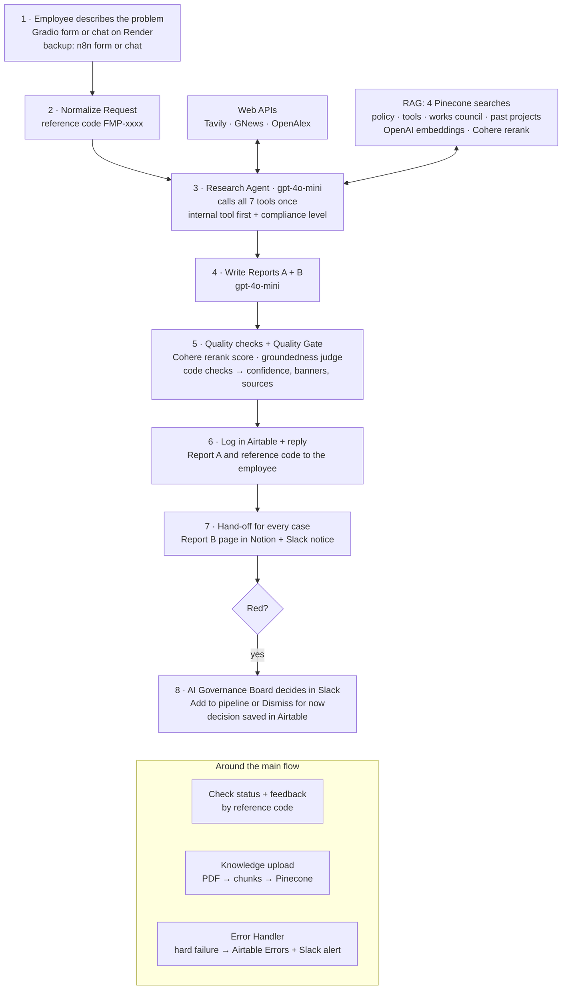

# Fix My Process Agent

**An autonomous n8n agent for Kleinanzeigen. An employee describes a process problem once. The agent researches it, checks it against internal rules and tools, and returns two reports: a safe fix the employee can use today, and a compliance-checked AI use case for leadership.**

Ironhack AI Consulting & Integration Bootcamp · Project 3: Autonomous Company Research & Report Generation Agent · solo project by Ayhan Demir

**Live demo:** https://fix-my-process.onrender.com (free Render plan: the first visit takes about 1 minute to wake the app)

> All internal documents, cases and tool names are fictional demo data. Kleinanzeigen is the setting; no real company data is used.

| Decision | Choice |
|---|---|
| **Industry / use case** | Online classifieds marketplace (Kleinanzeigen): internal operations, process excellence and AI enablement |
| **Primary stack** | **n8n** (self-hosted 2.13.2). Gradio on Render is the UI only |

**Contents:**  
[1 Problem and users](#1-problem-and-users)   
[2 How it works](#2-how-it-works)  
[3 Why n8n](#3-why-n8n-stack-decision)  
[4 Tools and knowledge base](#4-tools-and-knowledge-base)  
[5 Reports, compliance and confidence](#5-reports-compliance-and-confidence)  
[6 Error handling](#6-error-handling)  
[7 Setup](#7-setup)  
[8 How to run](#8-how-to-run)  
[9 Quality, calibration and cost](#9-quality-calibration-and-cost)  
[10 Future GTM sprints](#10-future-gtm-sprints)  
[11 Repo map, known gaps and docs](#11-repo-map-known-gaps-and-docs)

---

## 1. Problem and users

Kleinanzeigen is becoming a standalone company. In a change like this, three things happen at once:

- **Employees feel friction every day** (repeated manual tasks, slow processes, unclear tools) but have no simple way to turn a frustration into a fix.
- **The AI enablement team needs real use cases with evidence**, not vague ideas or top-down guesses about what operations needs.
- **Every AI or process idea must pass German rules:** the internal AI policy, the approved tools list, the works council (Betriebsrat) agreement, GDPR and the EU AI Act. Nobody checks this early, so good ideas stall late.

Today the path from "this is annoying" to research, compliance check and proposal is done by hand, slowly, or not at all.

**One submission, two reports:**

| Report | Reader | What "useful" means |
|---|---|---|
| **Report A** | Operations employee or team lead, OEE team | A safe next step with an approved tool, ready the same day: numbered steps, a request to copy, and "is it allowed?" |
| **Report B** | CPO / AI enablement team | A use-case card: evidence, compliance level with rule IDs, effort vs impact, tool and access gaps, so they can prioritise |

Bottom-up demand feeds a top-down AI portfolio. The employee is the user: people get help, they are not monitored. The project combines two candidate ideas, an AI friction report for leadership and an AI use-case scout for employees, because both readers need the same research and only the report step differs.

## 2. How it works

After the employee clicks **Find my fix**, one run does everything without a human. Only red cases wait for a human decision for pipeline entry, and only after the employee already has the answer.



| Step | n8n node(s) | What happens |
|---|---|---|
| 1 Intake | App Form Intake, App Chat Intake (webhooks with Header Auth) · n8n Form, n8n Chat (backup) | The app posts department, problem, tools, frequency and a session ID |
| 2 Normalize | Normalize Request | Reference code `FMP-{execution id}`, channel and default values for empty fields |
| 3 Research + compliance | Research Agent (AI Agent, Chat Memory, Research Output parser) | Calls the 3 web tools and the 4 internal searches once, picks the internal tool and an approved external tool, classifies green / amber / red with rule IDs, returns one JSON |
| 4 Reports | Write Reports A + B (Reports Output parser) | Report A for the employee (300 to 450 words) and Report B for leadership |
| 5 Quality | Cohere Rerank Score · Groundedness Check · Quality Gate (Code) | Relevance of the cited internal sources, an LLM judge that checks each claim against the raw tool results, then code checks, confidence score, header, banners and a sources list written by code |
| 6 Log + reply | Log Submission (Airtable) · Reply to User | One Submissions row per case; Report A and the reference code go back to the app |
| 7 Hand-off | Create Report B (Notion) · Notify AI Governance (Slack) | For every case |
| 8 Review | Needs Review? · Ask AI Governance Board (Slack send and wait) · Save Board Decision | Red cases only; the decision is saved on the same Airtable row |

| Flow around it | Starts with | What it does |
|---|---|---|
| Check status | `POST /status` | Finds the Airtable row by reference code: status, Board decision, Report A. No LLM call |
| Feedback | `POST /feedback` | Saves "Will you use the suggested internal tool?" and the reason on the same row |
| Knowledge upload | n8n form "Upload Knowledge PDF" | One PDF per namespace: extract text, chunk by section, embed, store in Pinecone (replaces that namespace) |
| Error Handler | Separate workflow with an Error Trigger | Airtable Errors row + Slack alert (section 6) |

## 3. Why n8n (stack decision)

**n8n is the primary stack. LangGraph is not part of the MVP.**

Fix My Process is an operations workflow, not an open-ended reasoning problem. It has intake, one research pass, a compliance classification, two reports for two readers, human review for red cases, logging and error handling. The flow is mostly linear with a few branches, and n8n has a ready node for every business system it touches: webhooks, Slack send-and-wait for the Board, Airtable, Notion and a separate error workflow. The value only appears when the output reaches people and is tracked, so connecting systems matters more than complex agent reasoning. One visible canvas also lets non-technical stakeholders, such as the OEE team and the works council, see where the LLM is used and which data it sees.

LangGraph stays the upgrade path for a step that must loop back with state, for example "tool not approved, find an approved alternative, check again" (GTM sprint 3). Small Code nodes (Quality Gate, Chunk by Section) are helpers; the orchestration stays in n8n. Full write-up: [`stack_decision.md`](stack_decision.md).

## 4. Tools and knowledge base

**Agent tools** (all called by the Research Agent in its first step):

| Tool | API | Used for | Settings |
|---|---|---|---|
| Tavily Web Search | Tavily `/search` | How other companies solve the problem | Basic depth, 5 results (title, url, content) |
| GNews Search | GNews `/v4/search` | Recent news on AI tools for the problem | English, 5 articles, 2 to 4 plain keywords |
| OpenAlex Research | OpenAlex `/works` | Related research papers (title and year only) | Keyword search, 5 papers |
| Search Approved Tools · Search Policy · Search Works Council · Search Past Projects | Pinecone (RAG) | Internal tools, rules, works council terms and similar past projects | topK 8 per namespace; Cohere rerank on Approved Tools and Policy |

**Services:**

| Service | Role |
|---|---|
| OpenAI gpt-4o-mini | Research Agent (temperature 0.2), Write Reports A + B (0.4), groundedness judge (0) |
| OpenAI text-embedding-3-small (1536) | Embeddings for the upload and the 4 searches |
| Pinecone | Index `fix-my-process-kb` (1536, cosine), one namespace per PDF |
| Cohere rerank-v3.5 | Reranks 2 internal searches; the Rerank Score feeds the confidence score |
| Airtable | Submissions and Errors tables |
| Slack | `#ai-governance-review` (notice for every case, Board decision for red) · `#fix-my-process-alerts` (errors) |
| Notion | One Report B page per case under "Fix My Process: Use Cases" |
| Gradio 6 on Render | UI only: Form, Chat and Check status tabs. No business logic and no AI keys |

**Knowledge base (RAG):** 4 fictional internal PDFs in [`Knowledgebase/`](Knowledgebase/). RAG is needed because the right answer depends on internal rules and tools that no web search knows.

| PDF | Doc ID | Namespace | Contents |
|---|---|---|---|
| `01_KA_Internal_AI_Policy.pdf` | KA-AI-POL-001 | `policy` | Data classes D1 to D5, rules G1 to G5, A1 to A7, R1 to R7, Annex A check questions |
| `02_KA_Approved_Tools_List.pdf` | KA-AI-TOOLS-002 | `tools` | 5 internal tools (KAi Assist, Ticket Lens, FlowMate, Knowledge Finder, Insight Desk) with steps, owners and max data class; 6 approved external tools; pilot and not-approved tools; how to request access |
| `03_KA_Works_Council_Agreement_AI.pdf` | KA-BV-AI-2026 | `works_council` | Information duty, co-determination, pre-approved uses |
| `04_KA_Past_AI_Projects.pdf` | KA-AI-PROJ-004 | `past_projects` | Past projects P-01 to P-09 with outcomes and patterns |

**Chunking:** the Chunk by Section code node splits each PDF at its real section headings (max 1,200 characters) and starts every chunk with `[doc_id · section]`, so the agent can cite the exact section. `doc_id`, `source`, `section_title` and `namespace` are stored as metadata.

## 5. Reports, compliance and confidence

**Internal first.** The agent uses the first case that fits, so every employee leaves with a next step (prompt v5):

| Case | When | What Report A gives |
|---|---|---|
| a. Full fit | An internal tool fits and is allowed for the data | The tool's steps and a sample request to copy |
| b. Fit without access | A fitting tool is not enabled for the employee | The same tool, with "Request access" as step 1 |
| c. Partial fit | A tool covers only a safe part of the task | Steps for that part; the limit is named |
| d. No fit | No internal tool fits | "What you can do today": 2 to 4 safe steps from the request process, plus a request to send |

Missing access to an approved tool is never a reason for amber or red.

**Compliance.** The agent classifies the use the employee describes, including a named not-approved tool or a step a rule flags, and follows the policy's Annex A questions in order:

| Level | Rules cited | What happens |
|---|---|---|
| 🟢 Green | G rules only | Report with steps |
| 🟠 Amber | A rules only | Report with steps; visible to the Board through the notice every case gets, but no decision step in the MVP |
| 🔴 Red | R rules only | "Not allowed yet" plus a safe alternative; the AI Governance Board decides in Slack: **Add to pipeline** or **Dismiss for now** |

**Report A** (employee, 300 to 450 words): Your problem · Fix it with an internal tool · Approved external alternative · How others solve it · Is it allowed? The Quality Gate adds the header (reference code, department, level, rule IDs, confidence), the banners and a sources list built by code, so the LLM never writes URLs.

**Report B** (CPO / AI enablement): executive summary plus a use-case card with the use case, problem and frequency, internal and external answer, evidence, compliance, effort, impact, related past project, tool owner, access gaps and tool improvement ideas. It is saved in Airtable and as a Notion page.

**Confidence score:**

```
confidence = 100 × (0.3 × rerank + 0.7 × groundedness) − 20 per invented item − 10 per missing item
```

- **rerank:** Cohere relevance of the cited internal sources to the problem.
- **groundedness:** an LLM judge checks every claim in both reports against the raw tool results.
- **Code checks:** an unknown internal tool, an unknown document ID, a URL not found in the search results or an invalid rule ID counts as invented. No internal source, no external source or no rule IDs counts as missing.
- **Bands:** High 75+, Medium 40 to 74, Low below 40. Every report below High shows a banner telling the reader to check the sources.

The score shows how well a report is backed by sources, not whether the compliance call is right (section 9).

**Sample reports**, generated by the system:

| Folder | Contents |
|---|---|
| [`samples/`](samples/) | Prompt v4: Report A and Report B for a green case (FMP-3110) and a red case (FMP-3112) |
| [`samples/before_fix/`](samples/before_fix/) | The same 2 inputs with prompts v1 to v3 (12 PDFs), showing the improvement |
| [`templates/`](templates/) | Target layouts of Report A and Report B, written before the build |

## 6. Error handling

| Failure type | Examples | What happens |
|---|---|---|
| **Entry** | Wrong webhook secret, workflow not active | n8n rejects the request before a run starts; the app shows a clear message |
| **Hard** | Research Agent, OpenAI, Write Reports, Groundedness Check, Quality Gate, Airtable log, reply, Slack notice, Board step | The node retries, then the run stops. The Error Handler writes an Airtable **Errors** row and posts a Slack alert with the reference code, failed node, error message and execution link |
| **Soft** | Web tools, Cohere rerank, Notion page | The run continues and the employee still gets the report. A failed web tool is retried once by a prompt rule and never invented; rerank 0 caps confidence at 70 (Medium); a missing Notion page shows as "not created, see Airtable" in the Slack notice |

- **Settings (from the export):** On Error Continue is set only on the Cohere Reranker, Cohere Rerank Score, Create Report B (Notion), Chat Memory and the 3 output parsers. Every other main-chain node uses Stop, so a hard failure reaches the Error Handler.
- **Retries:** Research Agent 3 tries; Cohere Rerank Score 3 × 3 s; Airtable nodes 3 × 2 s; OpenAI models, Notion and Slack Retry On Fail. HTTP Request Tools have no retry setting, so the agent prompt retries a failed tool once.
- **Validation:** Header Auth on all 4 app webhooks; required fields checked in the app; default values in Normalize Request; output parsers with fixed lists (compliance level, approved external tools) and auto-fix; the GNews query is limited to plain words; the status lookup strips the reference code to letters, digits and hyphens before the Airtable search.
- **Proof:** 13 failure points were forced on purpose from the app and all passed. Tests, settings and the runbook are in [`error_handling_proofing.md`](error_handling_proofing.md); evidence is in [`error_screenshots/`](error_screenshots/).

## 7. Setup

**You need:** n8n (built on self-hosted 2.13.2), Python 3.11, and accounts for OpenAI, Pinecone, Cohere, Tavily, GNews, OpenAlex, Airtable, Slack and Notion. Render is optional, for hosting the UI.

**1. Clone and install the UI**

```bash
git clone https://github.com/ayhandemir7-LSSBB/project3-research-and-report.git
cd project3-research-and-report
python -m venv .venv && source .venv/bin/activate
pip install -r requirements.txt
```

**2. Create the external resources**

- Pinecone index `fix-my-process-kb`: 1536 dimensions, cosine.
- Airtable base with the tables **Submissions** and **Errors** (columns below).
- Slack channels `#ai-governance-review` and `#fix-my-process-alerts`; invite the Slack app to both.
- Notion parent page "Fix My Process: Use Cases", shared with your Notion integration.

**3. Create the n8n credentials** (n8n asks you to pick one per node on import):

| Credential | Type | Used by |
|---|---|---|
| OpenAi - Fix My Process | OpenAI | 3 chat models, 2 embeddings nodes |
| PineconeApi - Fix My Process | Pinecone | 4 Search nodes, Store in Pinecone |
| CohereApi NEW Fix My Process | Cohere | Cohere Reranker, Cohere Rerank Score |
| Tavily API | Header Auth (`Authorization: Bearer <key>`) | Tavily Web Search |
| GNews New apikey | Query Auth, parameter `apikey` | GNews Search |
| OpenAlex API | Query Auth with your OpenAlex API key | OpenAlex Research |
| Airtable Personal Access Token - Fix My Process | Airtable token | Log Submission, Find Submission, Save Feedback, Save Board Decision, Log Error in Airtable |
| Notion - fix my process | Notion | Create Report B |
| Slack Bot - Fix My Process | Slack | Notify AI Governance, Ask AI Governance Board, Alert Workflow Owner in Slack |
| FMP webhook secret | Header Auth, name `X-Webhook-Secret` | The 4 app webhooks (value = `WEBHOOK_SECRET`) |

**4. Import the workflows**

1. Import [`n8n_workflows/Fix My Process - Error Handler.json`](n8n_workflows/), then [`n8n_workflows/Fix My Process_ main.json`](n8n_workflows/).
2. Pick your credentials in each node. Re-select your Airtable base and tables, and paste your Notion page URL into Create Report B: the export holds the IDs of the original base and page.
3. In the main workflow's **Settings**, set **Error workflow** to "Fix My Process - Error Handler".
4. Publish (activate) both workflows.

**5. Load the knowledge base:** open the production URL of the **Upload Knowledge PDF** form and upload each PDF from `Knowledgebase/` with its namespace (table in section 4). Each upload replaces only that namespace.

<details>
<summary><b>Airtable columns</b></summary>

Log Submission maps the Quality Gate output automatically, so the Submissions column names must match exactly.

**Submissions:** `reference_code`, `execution_id`, `created_at`, `channel`, `department`, `problem`, `current_tools`, `frequency`, `status`, `compliance_level`, `policy_rules`, `confidence`, `confidence_label`, `rerank_score`, `groundedness_score`, `low_confidence`, `internal_tool`, `external_tool`, `no_internal_solution`, `use_case_title`, `executive_summary`, `effort`, `impact`, `related_project`, `tool_improvement_ideas`, `report_a`, `report_b`, `sources`, `review_status`, `review_note`, `reviewed_at`, `will_use`, `feedback_reason`, `feedback_at`, `duration_seconds`

**Errors:** `execution_id`, `created_at`, `workflow`, `node`, `error_message`, `reference_code`, `resolved`, `resolution_note`, `execution_url`

</details>

## 8. How to run

**Live demo:** open https://fix-my-process.onrender.com.

- **Form tab:** choose a department, describe the problem, add tools and frequency, click **Find my fix**. A report usually takes about 45 seconds. Rate it in the feedback box below it.
- **Chat tab:** the same as a conversation. Every message is a full run.
- **Check status tab:** enter the reference code (FMP-xxxx) to see the status and the Board decision.
- **Test cases:** use "Try an example" in the app, or the 15 labelled cases in [`calibration/calibration_cases.csv`](calibration/calibration_cases.csv). G01 (weekly ops update, green) and R03 (CV screening, red) show both ends.

**Run the UI locally:** create a `.env` file (it is git-ignored):

```bash
N8N_WEBHOOK_URL=https://<your-n8n>/webhook
WEBHOOK_SECRET=<same value as the FMP webhook secret credential>
LOGO_URL=<optional>
```

Then run `python app.py` and open http://localhost:7860.

**Deploy the UI on Render:** Web Service from this repo, branch `main`. Build command `pip install -r requirements.txt`, start command `python app.py`. Set only `N8N_WEBHOOK_URL`, `WEBHOOK_SECRET` and optionally `LOGO_URL`. Do not set `PORT` (Render sets it and the app binds `0.0.0.0`) or `PYTHON_VERSION`. There are no AI keys on Render: every key lives in the n8n credentials.

**Run without the app:** use the n8n Form (backup) or n8n Chat (backup) URL, or call the webhook directly:

```bash
curl -X POST "$N8N_WEBHOOK_URL/form" \
  -H "X-Webhook-Secret: $WEBHOOK_SECRET" -H "Content-Type: application/json" \
  -d '{"department":"Operations","problem":"Every Friday I write the weekly ops update by hand from an aggregated KPI sheet.","current_tools":"Excel / Google Sheets","frequency":"Weekly","session_id":"test-1"}'
```

On the free tiers, leave about 1 minute between runs (the Cohere trial allows 10 calls a minute). The app waits up to 180 seconds for a reply.

## 9. Quality, calibration and cost

| Measure | Result |
|---|---|
| Prompt iterations: 2 fixed inputs, prompts v1 to v4, 6-check rubric | 25% → 83% correct |
| 15-case study: 13 cases, 19 runs, prompt v4 | 79% overall: level 84%, core rule 74%, internal tool 95%, external tool 63%; led to 2 fixes  |
| Confidence vs correctness | r = 0.35 with the rubric; 2 of 5 High runs were wrong. The score shows source support, not correctness |

Details: [`confidence_calibration.md`](confidence_calibration.md).

| Cost | Per run | Per 1,000 runs |
|---|---|---|
| Expected at list prices | $0.021 | $21 |
| Demo on free tiers (only OpenAI is paid) | $0.006 | $6 |

The LLM is only 28% of the cost; Tavily (38%) and Cohere (29%) drive the rest. The first free limit is the Cohere trial, at about 330 runs a month. Details, free-tier limits and cost levers: [`cost_analysis.md`](cost_analysis.md).

## 10. Future GTM sprints
 
These sprints come next; none of them is built yet. Order follows the sponsor: the CPO / AI enablement team funds the next step, so their value comes first.
 
| Sprint | Goal | Audience | Channel / motion | Success metric |
|---|---|---|---|---|
| **1. Close the loop** | Turn logged submissions and feedback into roadmap decisions | CPO / AI enablement team, internal tool owners | Scheduled n8n digest in Slack, reviewed in the monthly AI roadmap meeting | Share of "won't use the internal tool" reasons categorised; "no internal solution" cases turned into roadmap items |
| **2. Meet them where they work** | Grow submissions and adoption by moving intake into Slack | 1 or 2 operations pilot teams | Slack entry point introduced in team meetings by the OEE team, plus PII redaction | Submissions per week; internal tool adoption rate; feedback rate |
| **3. Smarter and trusted** | Earn works council and Legal trust for a company-wide rollout | Works council, Legal, CPO | Joint review sessions; quarterly compliance report; amber handling agreement | Cases auto-cleared vs reviewed; review turnaround; High-confidence reports passing a spot check |
 
### Planned reports
 
The MVP writes 2 reports per case. The sprints add 4 reports that summarise all cases. They read the same Airtable data, so they need no new intake.
 
| Report | Reader | Goal | Content | Data already logged | When |
|---|---|---|---|---|---|
| **A: Fix for me** | Employee, OEE team | Help the employee fix the problem today | Internal tool and steps, approved external alternative, how others solve it, is it allowed, sources | One per case | **MVP (built)** |
| **B: Use-case card** | CPO / AI enablement | Give leadership a scoped, compliance-checked use case | Executive summary, evidence, compliance, effort vs impact, tool gaps, improvement ideas | One per case (Airtable + Notion) | **MVP (built)** |
| **C: Portfolio digest** | CPO / AI enablement | Turn bottom-up submissions into roadmap input | Top friction themes per department, use cases ranked by impact and effort, "no internal solution" list, red cases the Board added to the pipeline | `use_case_title`, `effort`, `impact`, `no_internal_solution`, `review_status`, `department` | Sprint 1 (monthly) |
| **D: Adoption and internal-tool gap** | CPO, internal tool owners | Show why internal tools are not used and what to fix | Reasons per tool from the feedback, adoption per department (groups of 5 or more only), suggested fixes for each tool owner | `will_use`, `feedback_reason`, `internal_tool`, `department` | Sprint 1 (monthly) |
| **E: Compliance pipeline** | Works council, Legal | Make case handling transparent, as a condition for company-wide rollout | Cases in review, review turnaround, auto-cleared vs escalated | `compliance_level`, `status`, `review_status`, `created_at`, `reviewed_at` | Sprint 3 (quarterly) |
| **F: Ops health** | Workflow owner | Keep the agent reliable | Errors per node, failed APIs, low-confidence rate | Airtable Errors table, `confidence_label`; failed tools need the backlog field `failed_tools` | Sprint 3 |
 
Deliverables, milestones and the feature backlog: [`gtm_future_sprints.md`](gtm_future_sprints.md).


## 11. Repo map, known gaps and docs

```
Knowledgebase/              4 fictional internal PDFs (RAG corpus)
n8n_workflows/              main workflow and Error Handler (n8n exports, no keys)
calibration/                calibration_cases.csv: 15 labelled test cases
samples/                    sample Report A + B, green and red (prompt v4)
samples/before_fix/         the same inputs with prompts v1 to v3
templates/                  target layouts of Report A and Report B
error_screenshots/          evidence for the error tests
app.py, ui_style.py         Gradio UI (no business logic)
requirements.txt            gradio, requests, python-dotenv
stack_decision.md           n8n vs LangGraph
gtm_future_sprints.md       3 GTM sprints and the backlog
confidence_calibration.md   prompt iterations, 15-case study, confidence findings
error_handling_proofing.md  13 forced failures, settings, runbook
cost_analysis.md            cost per run, free-tier limits, cost levers
```

**Known gaps (MVP):**

- No login on the app or the upload form, and no PII redaction. PII redaction is planned in sprint 2.
- 1 of 19 study runs took 234 s, over the 180 s app timeout. The run still finishes and is logged, but the employee gets no reference code.
- Approved tool names are hardcoded in the agent prompt, the Research Output schema and the Quality Gate.
- Free tiers: the Cohere trial is non-production, the GNews free plan is non-commercial, Airtable Free allows 1,000 records per base, and the Render free plan sleeps.
