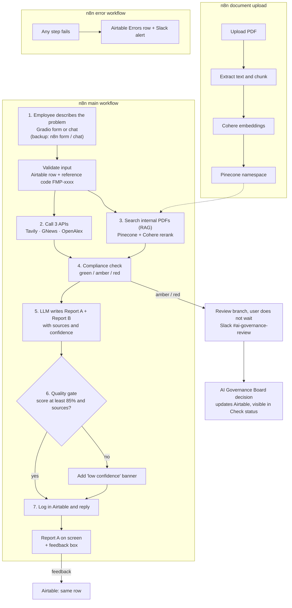

# Fix My Process Agent

An employee describes a process problem once. An n8n agent researches it, checks it against internal rules and tools, and returns a compliant fix (Report A) plus a use-case card for the CPO / AI enablement team (Report B). Demo company: Kleinanzeigen, with fictional internal data.

## Architecture

**In one line:** Trigger → Collect data (3 free APIs) → Check it (RAG / trusted docs) → Compliance → Report with sources → Log and reply

| Part | What it does |
|---|---|
| **Main workflow** | Steps 1 to 7: research, RAG, compliance, two reports, quality gate, log and reply |
| **Review branch** | Sends amber / red cases to the AI Governance Board; the user gets the report at once with an "under review" banner |
| **Document upload** | Adds or replaces one of the 4 internal PDFs in Pinecone |
| **Error workflow** | Logs failures in Airtable and alerts the owner in Slack |

## Tool list
_To be completed._

## Setup
_To be completed._

## How to run
_To be completed._

## Stack decision
See [`stack_decision.md`](stack_decision.md).

## Future GTM sprints
See [`gtm_future_sprints.md`](gtm_future_sprints.md).
