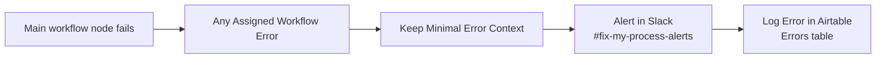

# Error Handling Proofing

*Fix My Process · n8n self-hosted 2.13.2 · tested 9 Nov 2026 · all internal data is synthetic*

Screenshots for the tests are in the `screenshots/` folder.

## 1. Summary

- 13 failure points were forced on purpose and checked from the Gradio app. **All 13 passed.**
- **Hard failures** (a main-chain node stops the run) go to the Error Handler. Each one creates a row in the Airtable **Errors** table and an alert in Slack **#fix-my-process-alerts**, and the app shows an error.
- **Soft failures** (Notion page, tool calls) never block the employee's answer.
- **Entry failures** (wrong secret, wrong URL) are stopped before n8n starts a run, so they only show in the app.

| Failure type | Example | Where it shows up |
|---|---|---|
| Entry | Wrong webhook secret, workflow not published | App message only (no n8n execution) |
| Hard | Agent, OpenAI, Cohere, Quality Gate, Airtable log, Slack notice | Errors row + Slack alert + app error |
| Soft | Notion page, research tools | Slack notice text or the execution only; the employee still gets the report |

## 2. How errors are handled

The main workflow's Settings point to the error workflow **"Fix My Process - Error Handler"**.

- **Keep Minimal Error Context** (Code) builds one record: time, workflow, execution ID, reference code `FMP-{execution id}`, failed node, error message (first 300 characters, because error texts can quote parts of the request) and the execution link.
- **Alert in Slack** posts the reference code, node, error and execution link. It has 3 tries and On Error: Continue, so the Airtable log still runs if Slack fails.
- **Log Error in Airtable** writes the row, with 3 tries.

**Errors table fields:** `execution_id`, `created_at`, `workflow`, `node`, `error_message`, `reference_code`, `resolved`, `resolution_note`, `execution_url`. The person who fixes the error fills in `resolved` and `resolution_note`, so both are empty on a new row.

## 3. Retry and On Error settings (main workflow)

| Node | Retry | On Error |
|---|---|---|
| Research Agent | 3 tries, 3000 ms | Stop |
| OpenAI models (agent, reports, judge), OpenAI Embeddings | Retry On Fail, 3000 ms | Stop |
| Cohere Reranker (Pinecone tools) | Retry On Fail, 5000 ms | Stop |
| Cohere Rerank Score | 5 tries, 5000 ms | Stop |
| Log Submission, Save Board Decision, Save Feedback, Find Submission | 3 tries, 2000 ms | Stop |
| Create Report B (Notion) | 3 tries, 3000 ms | Continue (Slack notice says "not created, see Airtable") |
| Notify AI Governance (Slack) | 3 tries, 3000 ms | Stop (the employee already has the reply at this point) |
| Tavily, GNews, OpenAlex (HTTP Request Tools) | No Retry On Fail setting on tool nodes | Agent prompt rule: retry once, then continue without inventing results |

## 4. Changes made during proofing

1. **Error Handler rebuilt**, with the same 4 nodes and positions:
   - Fixed the Airtable mapping, which had only saved `resolved: false`.
   - Slack channel set by name instead of an empty variable.
   - The real error message and the reference code are now saved.
   - Slack set to Continue on error.
   - Retries added.
2. **Airtable Errors table:** new field `execution_url`.
3. **Slack:** app invited to #fix-my-process-alerts.
4. **Main workflow:** the retry and On Error settings in section 3.
5. **Research Agent prompt:** retry a failed tool once, then continue.

## 5. Test results

**Procedure:**
- One test at a time.
- Each test started from the Gradio app. The Error Trigger only runs for production executions, not for editor test runs.
- Each temporary change undone and published after the test.
- About 1 minute between runs that reach the Research Agent, because of the Cohere trial limit.

| # | Failure point | How it was forced (temporary) | Expected trail | Result |
|---|---|---|---|---|
| 1 | App → webhook: wrong secret | Wrong `WEBHOOK_SECRET` in `.env` | App: "n8n rejected the request: WEBHOOK_SECRET does not match the Header Auth credential." No execution, no Errors row (by design) | PASS |
| 2 | App → webhook: wrong URL / not published | `N8N_WEBHOOK_URL` set to `/webhook-test` | App: "Webhook not found". No execution | PASS |
| 3 | App timeout (180 s) | App timeout lowered to 20 s | App shows a timeout; the n8n run still finishes and logs the submission | PASS |
| 4 | Research tools (Tavily, GNews, OpenAlex, Pinecone) | GNews URL changed to `/v4/searchx` | Agent retries once, continues, report still arrives; no Errors row | PASS |
| 5 | Research Agent / parser | Max Iterations 17 → 1 | Agent stops, parser fails, node retries, then Errors row + Slack alert + app error | PASS |
| 6 | OpenAI (Groundedness Check) | Judge model set to `gpt-4o-mini-x` | 3 tries, then Errors row + Slack alert + app error | PASS |
| 7 | Cohere Rerank Score | URL changed to `/v2/rerankx` | 5 tries, then Errors row + Slack alert + app error (a real 429 takes the same path) | PASS |
| 8 | Quality Gate (code) | `throw new Error('Forced test: Quality Gate');` | Errors row + Slack alert + app error; `resolved` and `resolution_note` empty by design | PASS |
| 9 | Log Submission (Airtable) | Field `sources` renamed in Airtable | 3 tries, then Errors row ("unknown field") + Slack alert + app error | PASS |
| 10 | Create Report B (Notion) | One character of the page ID changed | Run stays green, report arrives, Slack notice says "not created, see Airtable"; no Errors row | PASS |
| 11 | Notify AI Governance (Slack) | Channel set to `#ai-governance-reviewx` (green case) | Report arrives, then Errors row + Slack alert | PASS |
| 12 | Check status: unknown code | `FMP-0000` entered in Check status | App shows "not found"; no error | PASS |
| 13 | Error Handler itself | Alert channel set to `#fix-my-process-alertsx`, then test 8 repeated | No Slack alert, but the Errors row is still created | PASS |

## 6. Error log evidence

The logged rows from these tests are in the `screenshots/` folder (error_logs screenshot). Each row shows the execution ID, time, workflow, failed node, error message, reference code and execution link.

## 7. Known gaps (accepted for the MVP)

| Gap | Why it is accepted | Next step |
|---|---|---|
| Entry failures (wrong secret, wrong URL) leave no Errors row | n8n rejects the request before a run starts; it is a setup error, not a workflow failure | None |
| After a timeout the employee has no reference code | The run still finishes and is logged | Backlog: async reply (code first, report in Check status) |
| Tool failures are not logged | The agent retries once and continues; the failure is visible in the execution's intermediate steps | Backlog: `failed_tools` field in the research output |
| A failed Notion page has no Errors row | The Slack notice reports it and Report B is in Airtable | None |
| If both Slack and Airtable fail in the Error Handler, nothing is logged | Only the n8n execution list shows it | None |
| A persistent Research Agent failure reruns all tools up to 3 times | Kept at 3 tries by choice; costs time and Cohere calls | Review in calibration |

## 8. How to handle an error (runbook)

1. Read the alert in **#fix-my-process-alerts**: reference code, node, error, execution link.
2. Open the execution link and check the failed node's input and output.
3. Fix the cause and run one normal case.
4. In the Airtable **Errors** table, tick `resolved` and write the `resolution_note`.

## 9. Ready to say (Q&A)

- "Every hard failure lands in Airtable and Slack within seconds, with the reference code, the failed node and a link to the run."
- "Failures after the reply, like Notion or the Slack notice, never cost the employee their answer."
- "I broke 13 failure points on purpose and checked the trail of each one; the evidence is in this file and the screenshots folder."
